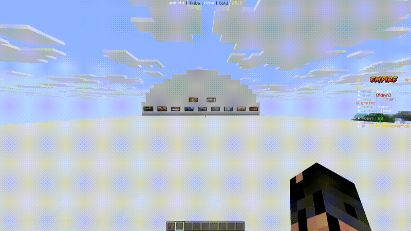

## 🎬 Demo



> ⚠️ **Premium Version**
>
> This repository contains a limited public version of ModelFramework.
> The complete version, including the full source code and all features, is available on Spigot.
>
> 🔗 **Spigot:** [Your Spigot Link]

## Features

*  Custom 3D model animations
*  Player interaction triggers
*  Item-based animation conditions
*  Advanced model and animation control
*  BetterModel integration
*  Optional ItemsAdder support

## License

This project is provided under the **ModelFramework License**.
See [`LICENSE`](LICENSE) for details.


# 🎮 ModelFramework

A lightweight, clean, and extensible Paper plugin framework for connecting **BetterModel** models to interactive world objects.

Transform any BetterModel model into a fully interactive object — crates, furniture, machines, doors, decorations, or anything you can imagine.

> **ModelFramework is not a crate plugin.**
> It's a generic framework. Crates are just one example.

---

## ✨ Features

- **YAML-Based Object Definitions** — Define objects entirely through configuration files
- **BetterModel Integration** — Seamless connection to BetterModel 3.3.0+ API
- **Animation System** — Trigger animations on interaction with full control (loop, play-once, callbacks)
- **Smart Interaction** — RIGHT_CLICK, LEFT_CLICK, SHIFT variants with item requirements
- **Item Provider System** — Oraxen and Vanilla item support with extensible provider architecture
- **Hand/Inventory Check** — Configure whether required items must be held in hand or just in inventory
- **State Machine** — Simple but powerful state system for objects (CLOSED → OPEN, OFF → ON, etc.)
- **Placement System** — Place objects via special items with automatic model spawning
- **Smart Rotation** — Models automatically face the direction the player is looking (snapped to 90°)
- **Scale & Offset** — Configure model scale and position offset per object definition
- **Category GUI** — Two-level GUI system: browse categories → pick objects (stays open for multiple picks)
- **Instance Persistence** — All placed objects survive server restarts
- **Security** — Only OPs can place/hold framework items; automatic cleanup for non-OP players
- **Action System** — Execute sounds, messages, and commands on animation triggers
- **Cooldown System** — Per-player, per-instance cooldowns
- **Condition System** — Permission checks, item requirements
- **Performance** — Fully event-driven, no tick loops, HashMap indexing
- **Debug Mode** — Comprehensive debug logging for development

---

## 📋 Requirements

| Dependency | Version | Required |
|---|---|---|
| **Paper** | 1.21.1+ | ✅ Yes |
| **Java** | 25+ | ✅ Yes |
| **BetterModel** | 3.3.0+ | ✅ Yes |
| **Oraxen** | 1.207.0+ | ❌ Optional |
| **PlaceholderAPI** | 2.11.6+ | ❌ Optional |

---

## 🏗️ Architecture
ModelFramework
│
├── BetterModelHook → BetterModel 3.3.0 API (EntityTracker, DummyTracker)
├── ObjectManager → YAML definition loading & category grouping
├── InstanceManager → Placed object lifecycle (create, remove, respawn, persist)
├── AnimationManager → Animation execution (loop, play-once, callbacks)
├── InteractionManager → Event-driven block interaction (no tick loops)
├── ConditionManager → Permission + item checks (hand/inventory)
├── ActionManager → Sound, message, command execution
├── PlacementManager → PDC-tagged items + block place/break handling
├── GUIManager → Two-level category GUI (browse → pick)
├── ItemSecurityListener → OP-only item security enforcement
│
├── Item Providers
│ ├── VanillaProvider → Standard Minecraft materials
│ └── OraxenProvider → Oraxen custom items (optional)
│
└── Commands
└── /model (reload|gui|give|debug|inspect|remove|list)

text


---

## 📁 File Structure
plugins/
└── ModelFramework/
├── config.yml # Main configuration
├── objects/ # Object definition files
│ ├── crates.yml # Each file = one GUI category
│ ├── furniture.yml
│ └── machines.yml
└── data/
└── instances.yml # Placed instance persistence

text


---

## ⚙️ Configuration

### config.yml

```yaml
debug: false

gui:
  title: "&8Model Categories"
  category-title: "&8Objects: %category%"
  size: 54

defaults:
  cooldown: 3

storage:
  auto-save: 5

messages:
  prefix: "&7[&bModelFW&7] "
  no-permission: "&cYou don't have permission!"
  object-not-found: "&cObject not found: &e%object%"
  placed: "&aObject &e%object% &aplaced successfully!"
  removed: "&cObject removed!"
  cooldown: "&cPlease wait &e%time% &cseconds!"
  reload: "&aConfiguration reloaded! &7(%time%ms)"
  item-given: "&aYou received &e%object%&a!"
  missing-item: "&cYou need &e%item% &cto do this!"
  no-console: "&cThis command can only be used by players!"
  inspect-header: "&7&m----------&r &bInstance Info &7&m----------"
  inspect-none: "&cNo instance found at target location."
  debug-enabled: "&aDebug mode enabled!"
  debug-disabled: "&cDebug mode disabled!"
📦 Object Definition
Each YAML file in objects/ defines one or more objects.
Each file becomes a category in the GUI.

Full Example
YAML

legendary_crate:

  # GUI display settings
  display:
    name: "&6✦ Legendary Crate"
    material: CHEST
    lore:
      - "&7Right-click to place"
    slot: 16                          # Slot position in category GUI (0-53)

  # BetterModel configuration
  model:
    id: legendary_crate               # BetterModel model ID
    scale: 1.0                        # Model scale (1.0 = default)
    offset-x: 0.0                     # X offset from block center
    offset-y: 0.0                     # Y offset from block center
    offset-z: 0.0                     # Z offset from block center

  # Block placement settings
  placement:
    type: BLOCK
    base-material: BARRIER            # Invisible block for interaction

  # State machine
  state:
    initial: DEFAULT                  # Initial state when placed

  # Animation definitions
  animations:

    # Animation triggered with required item
    open:
      animation: animation.common_crate.open    # BetterModel animation name
      loop: false                               # Play once, don't loop
      trigger:
        type: RIGHT_CLICK                       # Trigger type
      item:
        provider: oraxen                        # Item provider (oraxen/vanilla)
        id: "Legendary Key"                     # Item ID
        consume: true                           # Consume item on use
        check: HAND                             # HAND or INVENTORY
      cooldown:
        time: 3                                 # Cooldown in seconds
      actions:
        - type: SOUND
          sound: entity.firework_rocket.blast
          volume: 1.0
          pitch: 0.6

    # Fallback animation when item not present
    idle:
      animation: animation.common_crate.idle
      loop: false
      trigger:
        type: RIGHT_CLICK
      item:
        required: false
      cooldown:
        time: 1
      actions:
        - type: SOUND
          sound: entity.villager.no
          volume: 0.5
          pitch: 1.2
🎯 How It Works
Object Lifecycle
text

YAML Definition
    ↓
/model gui → Category GUI → Object GUI → Click item
    ↓
Player receives PDC-tagged item
    ↓
Player places item (OP only)
    ↓
Framework creates:
  ├── Base block (BARRIER) for interaction detection
  ├── ItemDisplay entity for model rendering
  ├── BetterModel EntityTracker attached to ItemDisplay
  └── Instance saved to instances.yml
    ↓
Player interacts (RIGHT_CLICK on base block)
    ↓
Framework checks:
  ├── Trigger type match
  ├── State requirement
  ├── Permissions
  ├── Cooldown
  └── Item requirement (hand/inventory)
    ↓
If item-required animation matches → play animation + consume item
If no item match → fallback to non-item animation (idle)
    ↓
Execute actions (sound, message, command)
    ↓
Update state if configured
Animation Priority
When multiple animations share the same trigger:

Item-required animations are checked first
If the player has the required item → that animation plays
If not → falls through to non-item animations (fallback/idle)
🎨 Trigger Types
Trigger	Description
RIGHT_CLICK	Right-click on object
LEFT_CLICK	Left-click on object
SHIFT_RIGHT_CLICK	Shift + right-click
SHIFT_LEFT_CLICK	Shift + left-click
NONE	No trigger (definition only)
🎵 Action Types
YAML

actions:
  # Play a sound
  - type: SOUND
    sound: entity.firework_rocket.blast    # Minecraft sound key
    volume: 1.0
    pitch: 1.0

  # Send a message
  - type: MESSAGE
    message: "&aHello %player%!"

  # Execute a command
  - type: COMMAND
    command: "give %player% diamond 1"
    executor: CONSOLE                       # CONSOLE or PLAYER
🔑 Item Providers
Vanilla
YAML

item:
  provider: vanilla
  id: DIAMOND                    # Bukkit Material name
  consume: true
  check: HAND
Oraxen
YAML

item:
  provider: oraxen
  id: "Legendary Key"            # Oraxen item ID
  consume: true
  check: HAND                    # HAND = must be held, INVENTORY = anywhere
Item Check Modes
Mode	Description
HAND	Item must be in main hand or off hand
INVENTORY	Item can be anywhere in inventory
🔧 Commands
Command	Description	Permission
/model gui	Open category selector GUI	modelframework.admin
/model give <object>	Get an object placement item	modelframework.admin
/model reload	Reload configuration	modelframework.admin
/model inspect	Inspect target block instance	modelframework.admin
/model remove	Remove target block instance	modelframework.admin
/model list	List all registered objects	modelframework.admin
/model debug	Toggle debug mode	modelframework.admin
Aliases: /mf, /modelfw

🔒 Security
Only OP players can place framework object items
Non-OP players who somehow obtain framework items will have them automatically removed:
On join
On interact
On inventory click
On pickup
On drop
🧭 Smart Rotation
When placing an object, the model automatically rotates to face the direction the player is looking, snapped to the nearest 90°:

Direction	Yaw
South	0°
West	90°
North	180°
East	270°
Rotation is saved and restored on server restart.

📐 Scale & Offset
Each object can have custom scale and position offset:

YAML

model:
  id: my_model
  scale: 1.5              # 1.5x size
  offset-x: 0.0           # Horizontal offset
  offset-y: 0.5           # Vertical offset (above block center)
  offset-z: 0.0           # Depth offset
Scale is applied via BetterModel's ModelScaler API after tracker initialization.

🗂️ GUI System
Two-Level Navigation
Level 1 — Categories
Each .yml file in objects/ becomes a category button.

text

/model gui
    ↓
┌─────────────────────────────────┐
│  Crates    Furniture    Machines │
│                                  │
└─────────────────────────────────┘
Level 2 — Objects
Click a category to see its objects.

text

Click "Crates"
    ↓
┌──────────────────────────────────────┐
│  Common    Rare    Epic    Legendary  │
│                                      │
│                              ← Back  │
└──────────────────────────────────────┘
Click any object → receive the placement item
GUI stays open → take as many as you want
Back button → return to categories
Close manually when done
🔄 Instance Persistence
All placed objects are saved to data/instances.yml and automatically restored on:

Server restart
/model reload
Saved data includes:

Object ID
World, coordinates, yaw
Current state
🚀 Performance
ModelFramework is designed for production servers:

Event-driven — No tick loops or scheduled scans
HashMap indexing — O(1) instance lookup by location
Lazy YAML loading — Config read only on startup/reload
ConcurrentHashMap — Thread-safe instance storage
Minimal entity overhead — One ItemDisplay per placed object
🔌 Extending
Adding a new Item Provider
Java

public class MyProvider implements ItemProvider {
    public String getName() { return "myplugin"; }
    public boolean hasItem(Player player, String itemId) { ... }
    public boolean hasItemInHand(Player player, String itemId) { ... }
    public void consumeItem(Player player, String itemId, int amount) { ... }
    public void consumeItemInHand(Player player, String itemId, int amount) { ... }
    public ItemStack createItem(String itemId) { ... }
}
Adding a new Action Type
Add a new enum value to ObjectAction.ActionType and handle it in ActionManager.

Adding a new Trigger Type
Add a new enum value to TriggerType and map it in InteractionManager.determineTrigger().

📊 Use Cases
Use Case	How
Crates	Model + open animation + key requirement
Doors	Model + open/close animations + state toggle
Furniture	Model + scale/offset + no interaction needed
Machines	Model + start/stop animations + item fuel
Decorations	Model + idle animation loop
NPCs	Model + click response + command actions
Shops	Model + click trigger + command to open shop
🛠️ Building
Bash

# Clone
git clone https://github.com/YOUR_USERNAME/ModelFramework.git
cd ModelFramework

# Build
mvn clean package

# Output
target/ModelFramework-1.0.0.jar
Requirements
Java 25+
Maven 3.8+
📄 License
This project is licensed under the MIT License.

🙏 Credits
BetterModel — Model rendering engine
Paper — Server platform
Oraxen — Custom item support (optional)
📞 Support
Issues: GitHub Issues
Wiki: Coming soon
ModelFramework — Turn any BetterModel model into an interactive world object.
Define in YAML. Place in world. Interact with animations.
